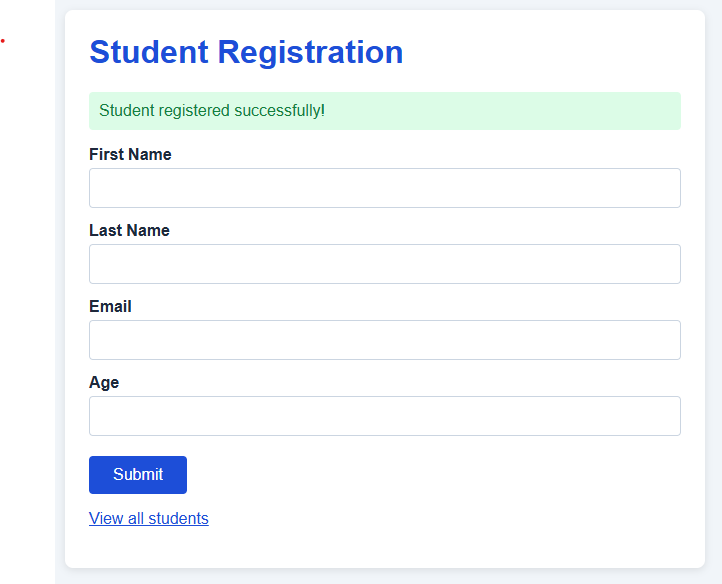
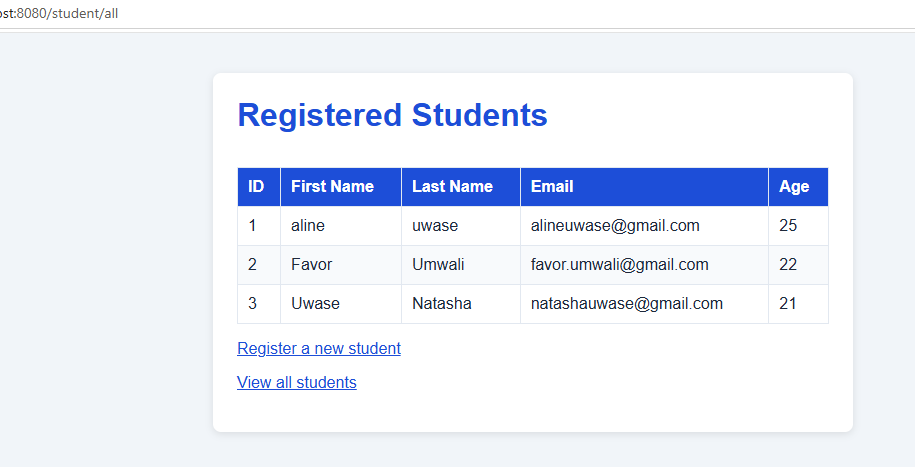
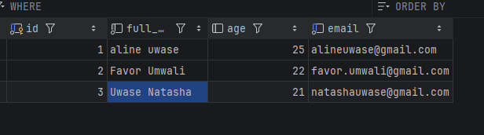

# Student Registration and Management System

A web application for registering students and viewing the saved list. It is built with Spring MVC and Thymeleaf,
and stores its data in PostgreSQL through plain JDBC, with no JPA or Hibernate.

## Built with
Java 17, Spring Boot (Spring MVC), Thymeleaf, PostgreSQL, JDBC, Maven

## Project structure
```
org.example.studentmanagement
├── config        DatabaseConfig            (DataSource bean)
├── controller    StudentController
├── model         Student
├── repository    StudentRepository         (interface)
│                 JdbcStudentRepository     (JDBC + SQL
└── service       StudentService            (interface)
                  StudentServiceImpl

resources
├── application.properties
├── static/style.css
└── templates/register.html, students.html
```

## Database
Create the database `student_management`, then the table:

```sql
CREATE TABLE students (
    id SERIAL PRIMARY KEY,
    full_name VARCHAR(150) NOT NULL,
    age INTEGER CHECK (age > 18),
    email VARCHAR(150) UNIQUE NOT NULL
);
```

The form asks for first and last name separately, but the table keeps one `full_name` column. The repository joins the two before the INSERT and splits them again when reading.

## Running it
1. Create the database and table above.
2. Set your password as an environment variable so it never reaches GitHub: `DB_PASSWORD=your_password` (in IntelliJ: Run > Edit Configurations > Environment variables). `DB_URL` and `DB_USERNAME` are optional and default to localhost and `postgres`.
3. Run `StudentmanagementApplication`.
4. Open http://localhost:8080/student/register

## How Spring wires it together
IoC means I don't create the objects, Spring does. At startup it scans the project, finds the annotated classes and builds one bean of each, then hands every bean what it needs through its constructor:

- `DatabaseConfig` (`@Configuration`) builds the `DataSource` bean from `application.properties`.
- `JdbcStudentRepository` (`@Repository`) receives that `DataSource`.
- `StudentServiceImpl` (`@Service`) receives a `StudentRepository`.
- `StudentController` (`@Controller`) receives a `StudentService`.

That is constructor injection, and there is no `new` for the service or repository anywhere. Each layer depends on an interface rather than a concrete class, so the JDBC code could be swapped without touching the service or controller.

## Handler mappings
`@RequestMapping("/student")` sets the shared path for `StudentController`.

| Method | URL | What happens |
|---|---|---|
| GET | `/student/register` | Shows the empty form (`register.html`) |
| POST | `/student/register` | `@ModelAttribute` receives the form, it is validated and saved, then the app redirects back to the form with a success message |
| GET | `/student/all` | Loads all students into the `Model` and shows `students.html` |
| GET | `/student/{id}` | Bonus: `@PathVariable` reads the id and the same `students.html` shows that one student, or a "not found" message |

The redirect after a successful save means refreshing the page can't save the same student twice.

## Validation
The form requires every field, a valid email and an age above zero. The database adds its own rules (age over 18, unique email), and the app turns those into readable messages instead of an error page.

## Screenshots
**Registration page**



**Student list**



**Saved records in pgAdmin**

